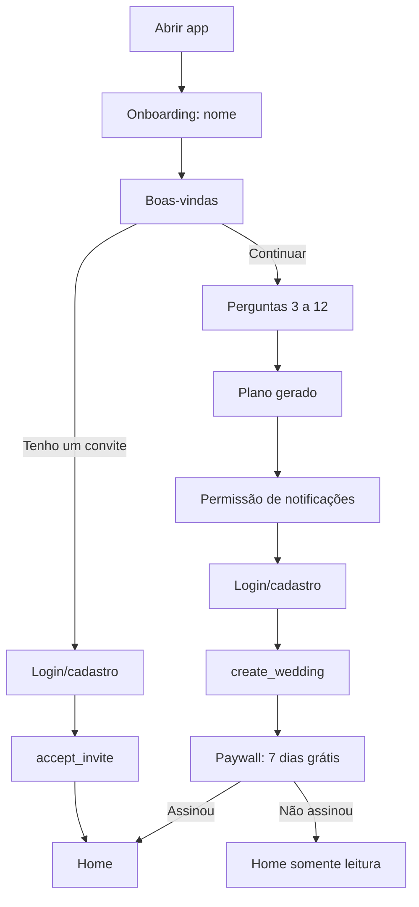

# 02 — Fluxos e telas

## Fluxo principal
1. **Onboarding** sem conta; respostas ficam no aparelho.
2. **Plano gerado**: carregamento curto e resumo por grupo.
3. **Login/cadastro** (e-mail e senha ou Google): cria o casamento e grava as respostas (`create_wedding`).
4. **Paywall**: 7 dias grátis, depois plano mensal.
5. **Home**.

## Convite do parceiro(a)
O dono gera um código/link (uso único, 7 dias) na tela Casal. O convidado escolhe "Tenho um convite" na boas-vindas, faz login, o app chama `accept_invite` (o código só é validado após o login), entra no mesmo casamento e **não passa por onboarding nem paywall**.

## Diagrama do fluxo de entrada

## Onboarding — 16 etapas
| # | Tela | Dado guardado | O que muda no app |
| --- | --- | --- | --- |
| 1 | Nome | Nome | Personaliza textos |
| 2 | Boas-vindas | Nenhum | "Tenho um convite" leva ao login e ao casamento do parceiro(a) |
| 3 | Quem é você? (Noiva, Noivo, Outro(a)) | Papel | Textos |
| 4 | Onde ouviu falar da gente? | Origem | Mede aquisição |
| 5 | Data do casamento (pode ser aproximada) | Data | Prazos e dias que faltam |
| 6 | Destination ou perto de onde moram? | Tipo de local | Muda a lista de itens |
| 7 | Quantos convidados? | Nº de convidados | Base das estimativas |
| 8 | Orçamento total | Orçamento | Orçamento restante da home |
| 9 | O que mais te preocupa? (várias) | Preocupações | Textos e ordem da home |
| 10 | Já contratou fornecedor? | Sim/Não | Se sim, marca quais na lista |
| 11 | Estilo: Completo, Minimalista, Só o necessário | Estilo | Itens adicionais |
| 12 | Como quer usar o app? (várias) | Objetivos de uso | Textos e ordem da home |
| 13 | Montando o plano + resumo | Nenhum | Mostra valor antes do login |
| 14 | Permissão de notificações | Autorização | Habilita lembretes |
| 15 | Login/cadastro | Conta | Cria casamento e grava respostas |
| 16 | Paywall | Assinatura | Libera o app |

## Telas (11)
| Tela | Conteúdo | Ações |
| --- | --- | --- |
| Login/Cadastro | E-mail + senha, ou Google | Entrar, Criar conta, Esqueci a senha |
| Questionário | Perguntas do onboarding | Próximo, Voltar, Gerar meu plano |
| Paywall | Plano mensal, benefícios | Assinar, Restaurar compra |
| Home | Contratado, Pago, Falta pagar, Orçamento restante; próximos 3 vencimentos; próximos prazos | Ver todos os itens, Adicionar item |
| Itens | Lista por categoria com status | Adicionar, Filtrar, Abrir item |
| Detalhe do item | Fornecedor, estimado vs. fechado, parcelas, anexos, prazo | Editar, Adicionar parcela, Anexar contrato, Marcar como contratado |
| Parcela | Valor, vencimento, status | Marcar como paga (com data), Editar, Excluir |
| Checklist de decisões | Prazos em ordem de data, com check | Marcar como decidido, Adiar prazo |
| Relatórios | Gasto por categoria; pago vs. a pagar por mês | Exportar PDF/planilha |
| Casal | Quem está no casamento | Convidar parceiro(a), Remover |
| Configurações | Notificações, assinatura, conta | Gerenciar assinatura, Sair, Excluir conta |

## Números da home
| Número | Cálculo |
| --- | --- |
| Contratado | Soma dos valores fechados dos itens |
| Pago | Soma dos valores efetivamente pagos nas parcelas |
| Falta pagar | Contratado − Pago |
| Orçamento restante | Orçamento total − Contratado |

A view `wedding_summary` já entrega esses números (ver `05-banco-de-dados.md`).
