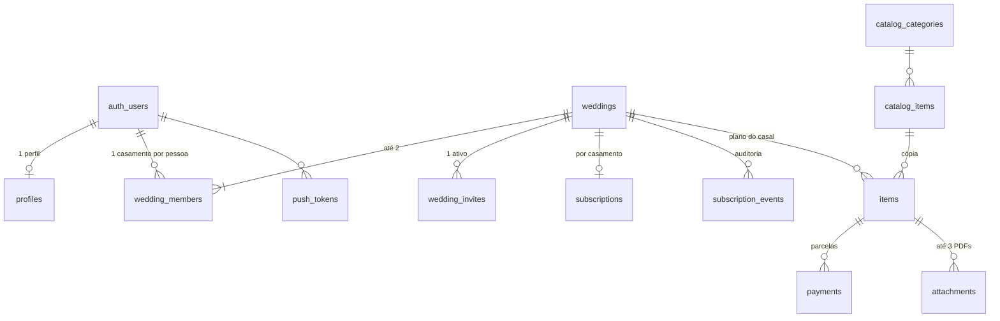

# 05 — Banco de dados

Fonte: `anexos/01_schema.sql`; versionado em `../supabase/migrations/`. Projeto `nhfujhpteolhndsyqsys`, Postgres 15+.

## Tabelas (12) e relações

| Tabela | Papel |
| --- | --- |
| `profiles` | Nome, papel, origem, preferências de push, `deletion_requested_at` |
| `weddings` | Data, convidados, orçamento, estilo, destination, preocupações, objetivos, `owner_id` (único) |
| `wedding_members` | Vínculo usuário–casamento (`owner`/`partner`) |
| `wedding_invites` | Código de uso único, 7 dias, revogável |
| `subscriptions` | Status e `entitlement_expires_at` por casamento |
| `subscription_events` | Idempotência e auditoria do webhook (`event_id` PK) |
| `catalog_categories`, `catalog_items` | Templates (8 e 54), públicos |
| `items` | Itens do casal (cópia do catálogo + próprios) |
| `payments` | Parcelas; `installment_no` 0 = entrada |
| `attachments` | Metadados dos PDFs (arquivo no storage) |
| `push_tokens` | Tokens FCM/APNs |

View: `wedding_summary` (`security_invoker`): `total_budget`, `contracted_total`, `paid_total`, `remaining_to_pay`, `budget_remaining`, `items_total`, `items_to_decide`.
Observação: `contracted_total` soma `contracted_amount` só de itens `contratado`/`pago`.

## Funções
**Chamáveis pelo app (role `authenticated`)** — todas `security definer`:
| RPC | O que faz |
| --- | --- |
| `create_wedding(...)` | Cria perfil, casamento, membro dono e gera o plano. Rejeita quem já tem casamento e data no passado |
| `create_invite()` | Só dono; revoga convite ativo e devolve código novo; falha se já há 2 pessoas |
| `accept_invite(code)` | Entra como `partner`; rejeita código inválido, usado, revogado ou expirado |
| `transfer_ownership()` | Dono passa a titularidade ao outro membro |
| `register_push_token(token, platform)` | Upsert do token do usuário |
| `request_account_deletion()` / `cancel_account_deletion()` | Marca/desmarca o pedido (o apagamento é rotina à parte) |

**Só `service_role` (app não chama):** `due_reminders(date)`.
**Schema `private` (não exposto pela API):** `is_member`, `is_owner`, `has_active_subscription`, `can_edit`, `shares_wedding`, `compute_deadline`, `generate_plan`, `safe_uuid`, funções de gatilho.

## Gatilhos
| Gatilho | Efeito |
| --- | --- |
| `*_touch` | Atualiza `updated_at` (e `updated_by` em itens e parcelas) |
| `members_limit` | Máximo 2 membros |
| `attachments_limit` | Máximo 3 anexos por item |
| `items_guard` | "Pago" só com todas as parcelas pagas; `decided_at`; marca prazo adiado |
| `payments_sync_item_status` | Contratado ↔ pago conforme as parcelas |
| `weddings_recalc_deadlines` | Recalcula prazos ao mudar a data |

## Modelo de segurança
Toda tabela tem RLS; privilégios mínimos (`revoke all` + `grant` por coluna). Escritas sensíveis (criar casamento, convite, titularidade) só por RPC.

| Tabela | Lê | Escreve |
| --- | --- | --- |
| `catalog_*` | Qualquer um (anon incluso), só ativos | Ninguém (migração) |
| `profiles` | O próprio e quem divide o casamento | O próprio (nome, papel, origem, notificações); `insert` do próprio |
| `weddings` | Membros | Membro com assinatura ativa: data, convidados, orçamento, preocupações, objetivos. Estilo/destination imutáveis. Delete: só dono (sem exigir assinatura) |
| `wedding_members` | Membros | Delete: dono remove convidado; convidado sai. Insert só por RPC |
| `wedding_invites` | Só o dono | Só por RPC |
| `subscriptions` | Membros | Só `service_role` (webhook) |
| `subscription_events` | Ninguém no app | Só `service_role` |
| `items`, `payments`, `attachments` | Membros | Membros **com assinatura ativa**; autoria (`created_by`) não é editável pelo app |
| `push_tokens` | O próprio | Delete do próprio; insert por RPC |

Por que RLS em tudo: o app fala direto com a API do Supabase com a chave pública; sem RLS qualquer usuário leria dados de outros casais. `has_active_subscription` = linha em `subscriptions` com status ≠ `expired` e `entitlement_expires_at > now()` (inclui `canceled` até o fim do período pago).

## Storage `contratos`
Bucket privado, 2 MB (2097152 bytes), só `application/pdf`. Caminho `{wedding_id}/{item_id}/{arquivo}.pdf`. Leitura: membros; escrita e remoção: membros com assinatura ativa. Metadados em `attachments` (check de path e tamanho).

## O que o app pode e não pode
| Pode | Não pode |
| --- | --- |
| `select` nas tabelas do próprio casamento e na `wedding_summary` | Chamar `due_reminders` |
| As 7 RPCs acima | Escrever em `subscriptions`/`subscription_events` |
| `insert/update/delete` em `items`, `payments`, `attachments` com assinatura ativa (colunas permitidas) | Alterar `created_by`, `updated_by`, `deadline_postponed`, `level`, `is_essential`, `lead_months`, `catalog_item_id` |
| Upload/download no bucket `contratos` (dentro das regras) | Usar a chave `service_role`; criar convites ou casamentos por `insert` direto; mudar estilo/destination |
