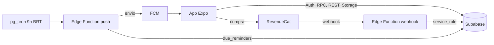

# 06 — Arquitetura

## Visão geral

## Onboarding: dados até o login
1. Respostas ficam no aparelho (armazenamento local) durante as telas 1–14.
2. O plano é montado no próprio app lendo `catalog_items` **sem login** (política pública).
3. No login (tela 15), o app chama `create_wedding(...)` com as respostas (inclusive IDs de itens já contratados). O banco gera o plano com prazos de `compute_deadline`.
4. Convidado: login → `accept_invite(code)`; nada de onboarding.
5. Um evento por tela para medir desistência (ferramenta de analytics: **em aberto**).

## Assinatura
1. Paywall usa RevenueCat com `app_user_id = wedding_id` (assinatura por casamento, não por usuário).
2. Compra/renovação/cancelamento → webhook do RevenueCat → edge function valida o segredo, grava `subscription_events` (idempotente por `event_id`) e faz upsert em `subscriptions`: `status` (`trialing`, `active`, `canceled`, `billing_issue`, `expired`), `will_renew`, `paid_by_user_id` e `entitlement_expires_at`.
3. O banco libera ou bloqueia escrita olhando `entitlement_expires_at > now()` e `status <> 'expired'`; o app lê `subscriptions` para a UI de somente leitura.
4. Teste de 7 dias: oferta introdutória no Play Console. "Restaurar compra" só funciona na conta Google de quem pagou.

## Push diário
1. `pg_cron` dispara às 9h de Brasília (12:00 UTC; o Brasil não tem horário de verão hoje, **confirmar**) a edge function.
2. A função chama `due_reminders()` com `service_role`: parcelas a 7/1/0 dias e decisões essenciais a 15/3 dias, só para casamentos com assinatura ativa e respeitando `notify_payments`/`notify_decisions`.
3. Busca `push_tokens` dos usuários e envia por FCM (via Expo push ou FCM direto: **em aberto**); remove tokens inválidos.
4. Push remoto exige development build (não funciona no Expo Go no Android).

## Exclusão de conta
`request_account_deletion` marca o pedido; uma rotina (edge function + cron) apaga arquivos do bucket, o casamento e o usuário após 30 dias. Atenção: `weddings.owner_id` tem `on delete restrict` em `auth.users`, então a rotina precisa apagar o casamento antes do usuário.
